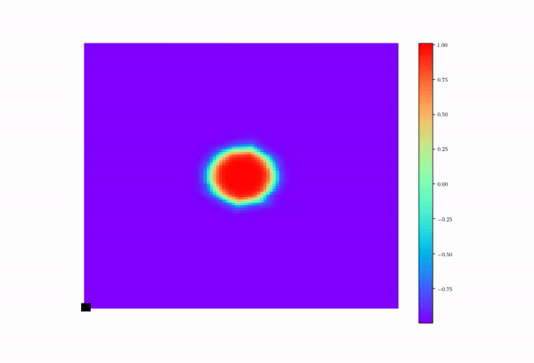

# CS 2470 Deep Learning, Brown University (2019)

My coursework for CS 2470 (Deep Learning) at Brown: seven programming assignments and a final project on physics-informed neural networks (PINNs).

Each assignment folder has the handouts (PDFs), the provided stencil code, and my implementation. The per-assignment `README` files record the results I reported.

## Assignments

| # | Topic | Framework | Result |
|---|-------|-----------|--------|
| [1](Assignment_1) | Single-layer classifier for MNIST, written from scratch | NumPy | 90.68% test accuracy |
| [2](Assignment_2) | Convolutional neural network for CIFAR images, including a hand-written `conv2d` ([convolution.py](Assignment_2/convolution.py)) | TensorFlow | — |
| [3](Assignment_3) | Language modeling with a trigram model and an RNN | TensorFlow | Perplexity ~188 (trigram), ~146 (RNN) |
| [4](Assignment_4) | French → English machine translation with an RNN seq2seq model and a Transformer | TensorFlow | Accuracy 68% (RNN), 74% (single-head), 85% (multi-head) |
| [5](Assignment_5) | Message-passing graph neural network for molecule classification | PyTorch + DGL | ~72% accuracy |
| [6](Assignment_6) | Policy-gradient reinforcement learning on CartPole: REINFORCE and REINFORCE with baseline | TensorFlow + Gym | Reward ~250 / ~450 |
| [7](Assignment_7) | DCGAN for face generation on CelebA | TensorFlow | FID ~200 |

### Running an assignment

Run each assignment from inside its folder so the local `preprocess.py` is importable:

```bash
cd Assignment_4
python assignment.py
```

Some assignments take arguments. For example, Assignment 6 needs the algorithm name:

```bash
python assignment.py REINFORCE            # or REINFORCE_BASELINE
```

Assignment 7 takes `--img-dir`, `--out-dir` and `--mode train|test`; see `python assignment.py --help`.

## Final project: PINNs for PDEs in mechanics

Team LGD: Wei Cheng, Minglang Yin, Enrui Zhang, Zongren Zou.

The project uses physics-informed neural networks to solve forward and inverse problems governed by partial differential equations.

| Folder | Description |
|--------|-------------|
| [final/Examples](final/Examples) | Introductory PINN examples: the Allen–Cahn equation (time-independent 2-D and time-dependent 1-D) and channel flow |
| [final/AC-NS](final/AC-NS) | Forward solution of the coupled Allen–Cahn / Navier–Stokes equations, with the 2-D Allen–Cahn and Navier–Stokes parts also solved on their own |
| [final/FlowAroundCylinder](final/FlowAroundCylinder) | Simplified 2-D Navier–Stokes flow around a cylinder |
| [final/PINNs_Solid](final/PINNs_Solid) | Inverse problem: inferring a spatially varying elastic modulus (quadratic and sinusoidal fields) from displacement data generated with Abaqus |
| [final/Slides](final/Slides) | Check-in and final presentation slides |

<p align="center">
  
</p>

The AC-NS and example scripts use PyTorch. The PINNs_Solid scripts use the TensorFlow 1.x graph API (`tf.placeholder`), so they need TensorFlow 1.x or `tf.compat.v1`.

## Requirements

The code was written for Python 3.7. Dependencies differ by folder:

- **NumPy, Matplotlib, SciPy**: used throughout
- **TensorFlow 2.x**: Assignments 2–4, 6 and 7
- **PyTorch + DGL**: Assignment 5 and most of the final project
- **gym**: Assignment 6
- **tensorflow-gan, tensorflow-hub, imageio**: Assignment 7 (for FID)
